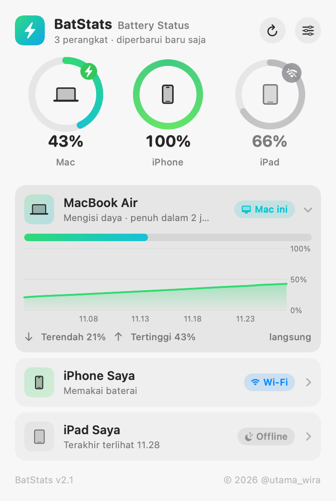
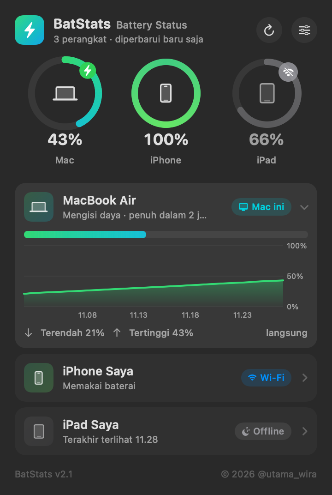
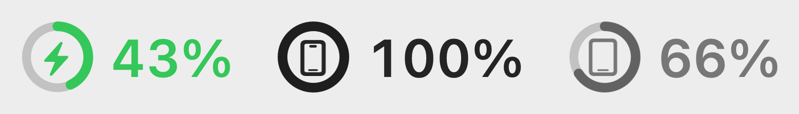
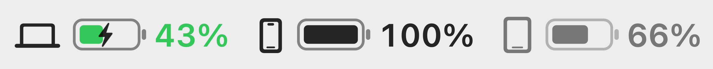
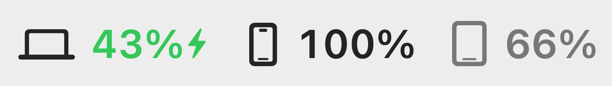

# BatStats — Battery Status

**Pantau baterai Mac, iPhone, dan iPad dari satu ikon di menu bar.**

BatStats adalah aplikasi menu bar kecil untuk macOS. Persentase baterai MacBook, iPhone, dan iPad kamu tampil berdampingan di pojok kanan atas layar, jadi kamu tidak perlu mengambil HP atau membuka widget hanya untuk mengecek sisa baterai. Data iPhone dan iPad dibaca lewat kabel USB atau langsung lewat Wi-Fi.

<p align="center">
  
  
</p>

## Fitur

- **Satu ikon untuk semua perangkat:** Mac, iPhone, dan iPad tampil sekaligus di menu bar.
- **Tiga gaya ikon:** pilih yang paling cocok dengan menu bar kamu.

  | Cincin | Baterai | Angka |
  |---|---|---|
  |  |  |  |

- **Panel interaktif:** cincin baterai beranimasi, lencana ⚡ saat mengisi daya, dan peringatan berdenyut saat baterai lemah.
- **Grafik riwayat 24 jam** untuk setiap perangkat, lengkap dengan angka terendah dan tertinggi.
- **Tanpa kabel:** membaca iPhone/iPad lewat Wi-Fi yang sama dengan Mac.
- **Notifikasi:** pengingat saat baterai di bawah batas yang kamu pilih (5–50%), dan kabar saat baterai sudah penuh.
- **Angka terakhir tetap tersimpan:** saat perangkat sedang "tidur" dari jaringan, angka terakhirnya tetap tampil (abu-abu).
- **Ringan dan tanpa dependensi:** ditulis dengan Swift, tidak perlu Homebrew, tidak ada server, dan tidak ada data yang keluar dari Mac kamu.
- **Bahasa Indonesia.**

## Kebutuhan

- macOS 14 (Sonoma) atau lebih baru
- Xcode atau Command Line Tools (`xcode-select --install`) untuk build
- iPhone/iPad yang sudah pernah disambungkan dan di-**Percayai** (Trust) di Mac tersebut

## Pasang

```bash
git clone https://github.com/utama-wira/BatStats.git
cd BatStats
./build.sh install
```

Ikon BatStats akan muncul di menu bar. Buka panel → ⚙︎ → nyalakan **Buka otomatis saat login** supaya BatStats selalu berjalan.

## Sambungkan iPhone & iPad

1. Colok perangkat ke Mac dengan kabel, buka kuncinya, lalu ketuk **Percayai**.
2. Buka **Finder** dan klik nama perangkat di sidebar.
3. Centang **"Tampilkan [perangkat] ini saat di Wi-Fi"**, lalu klik **Terapkan**.
4. Cabut kabel. Selama Mac dan perangkat berada di Wi-Fi yang sama, BatStats tetap bisa membaca baterainya.

> **Tips:** sembunyikan ikon baterai bawaan macOS (System Settings → Menu Bar/Control Center → Battery) supaya hanya BatStats yang tampil.

## Cara kerja

- **Baterai Mac** dibaca lewat IOKit (`IOPowerSources`), API resmi macOS.
- **Baterai iPhone/iPad** dibaca lewat `MobileDevice.framework`, framework bawaan macOS yang juga dipakai Finder untuk sinkronisasi perangkat. Pembacaan diperbarui setiap 60 detik dan setiap kali panel dibuka.

## Keterbatasan

- `MobileDevice.framework` adalah framework privat Apple. Karena itu BatStats **tidak bisa masuk Mac App Store**, dan pembaruan macOS di masa depan bisa saja mengubah perilakunya.
- iPhone/iPad kadang memutus Wi-Fi saat layarnya lama mati. Akibatnya angkanya bisa tertinggal beberapa menit sampai perangkat muncul lagi di jaringan.
- Aplikasi tidak ditandatangani dengan sertifikat Apple Developer. Kalau kamu membagikan file `.app` hasil build ke orang lain, macOS akan menampilkan peringatan saat pertama dibuka (klik kanan → **Open**). Build sendiri dengan `./build.sh` tidak memunculkan masalah ini.

## Struktur proyek

```
Sources/
  Core.swift        pembaca baterai Mac & iPhone/iPad, login item
  Store.swift       data, riwayat 24 jam, notifikasi
  StatusIcon.swift  gambar ikon menu bar (Cincin / Baterai / Angka)
  Panel.swift       panel interaktif (SwiftUI)
  main.swift        titik masuk aplikasi
build.sh            build & pasang
```

Uji cepat dari terminal:

```bash
./build/BatStats.app/Contents/MacOS/BatStats --dump
```

## Lisensi

Dirilis dengan [Lisensi MIT](LICENSE). Kamu bebas memakai, mengubah, dan membagikan aplikasi ini, asalkan tetap mencantumkan pemberitahuan hak cipta.

Copyright © 2026 **@utama_wira**
